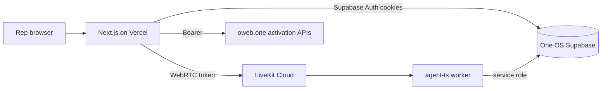

# AI Sales Trainer — MASTERPLAN

**App ID:** `sales_trainer`  
**Table prefix:** `st_`  
**Activation scope:** workspace  
**Upstream:** [livekit-examples/supabase-hacker-starter](https://github.com/livekit-examples/supabase-hacker-starter) (MIT) — license preserved in `LICENSE`.

## Product scope (v1)

| In scope | Out of scope (deferred) |
|----------|-------------------------|
| Realtime voice roleplay (LiveKit Agents TS worker) | Custom LLM fine-tuning |
| Scenario library + GHI CNA admissions seed | Multi-tenant billing / Stripe in satellite |
| English + Spanish scenario language | CRM write-back |
| Transcript, scorecard, coaching feedback, retry focus | Team-wide leaderboards v2 |
| Session history, certifications, coaching assignments | Python agent parity changes beyond smoke |
| Manager scenario editor + rep performance view | Anonymous demo auth |
| OneID native login + OWeb SSO + workspace activation | Bulk import / SCORM |

## Architecture



- **Control plane:** Next.js 15 (`frontend/`), deployed to Vercel project `sales-trainer`.
- **Voice runtime:** `agent-ts/` LiveKit Agents worker (not on Vercel). Dispatched with metadata `{ user_id, session_id, scenario_id, workspace_id, language }`.
- **Evaluation:** Post-session rubric scoring via server route + OpenAI (structured JSON), independent of the persona LLM.

## Data model (`st_*`)

| Table | Purpose |
|-------|---------|
| `st_profiles` | Local projection `id = auth.users.id`, display name (manager/admin via `ao_org_members`) |
| `st_scenarios` | Workspace-owned scenario definitions (persona, goals, hidden context, objections, rubric) |
| `st_sessions` | Roleplay session lifecycle + LiveKit room name |
| `st_transcript_lines` | Ordered transcript (rep / prospect / system) |
| `st_scorecards` | Rubric category scores + pass/fail + coaching |
| `st_certifications` | Passed scenario certifications per rep |
| `st_coaching_assignments` | Manager-assigned retry focus |
| `st_rep_stats` | Aggregated progress per workspace + user |

All workspace-owned rows include `workspace_id` (canonical `ao_orgs.id`). RLS uses `st_is_workspace_member` / `st_is_workspace_admin` against `ao_org_members`.

## Security

1. Shared Auth at `https://auth.oweb.one`, cookie storage key `ao-supabase-auth`.
2. No service role key in client bundles; SSO redeem server-only.
3. Never authorize from `user_metadata`.
4. LiveKit token route: authenticated user + activation + app grant + session row scoped to workspace.
5. Cross-workspace reads/writes denied by RLS and server checks.

## OneID / OWeb integration

- Native `/login` → `signInWithPassword` on One OS.
- Continue with OWeb → `https://oweb.one/login?launch=sales_trainer`.
- `/sso?launch_token=` → redeem `ao_ecosystem_launch_tokens` (SHA-256 hash, single consume).
- Post-auth: `POST /api/v1/oneid/activate` and `activate-workspace` via `OWEB_API_BASE_URL`.
- D15 workspace fallback when requested workspace not activated.
- App grants: owner/admin bypass; members require `ao_workspace_app_grants.status = granted`.

## Live agent behavior

- Persona instructions built from scenario public fields only; hidden prospect context injected as a **confidential** system block with explicit “never reveal” rule.
- Objection triggers and interruption via turn detector + short replies.
- Transcript lines appended from agent session events (server/agent write).
- End-of-call: mark session `completed`; client triggers evaluation job.

## Rubric categories

opening, discovery, qualification, value_presentation, objection_handling, closing, compliance — each 0–10, weighted; pass threshold from scenario (default 70%).

## Seed scenario

**GHI CNA Admissions — Price Objection** (English): prospect concerned about program cost; vertical-agnostic JSON schema.

## Acceptance tests

| # | Test |
|---|------|
| 1 | Native login with One OS credentials establishes session |
| 2 | Continue with OWeb URL includes `launch=sales_trainer` |
| 3 | Invalid/expired SSO shows actionable error |
| 4 | App + workspace activation idempotent |
| 5 | RLS denies cross-workspace scenario read |
| 6 | Member without grant blocked from dashboard |
| 7 | Production build succeeds |
| 8 | LiveKit token requires auth |
| 9 | Voice session connects when worker + LiveKit env present |

## Deployment

- Vercel: root directory `frontend`, env from One OS + OWeb (no bulk secret clone).
- Agent: LiveKit Cloud deploy (`lk agent deploy` / Docker per `agent-ts/Dockerfile`).

## OWeb registry (separate PR)

Add to `ecosystem-apps.ts`:

```ts
{
  id: "sales_trainer",
  name: "AI Sales Trainer",
  launchUrl: "https://sales-trainer-oweb.vercel.app", // or custom domain
  activationScope: "workspace",
  status: "beta",
  // packagesByTier: align with Revenue category
}
```
